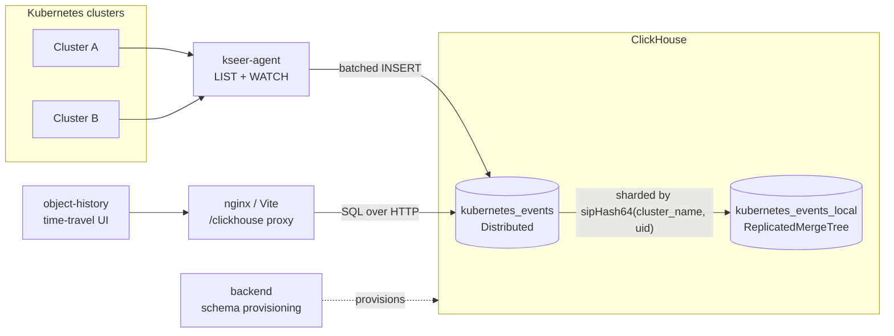

# KSeer

KSeer is a Kubernetes object-history platform. It continuously watches Kubernetes
objects across one or more clusters, streams every change into a ClickHouse event
store, and lets you replay and explore that history through an interactive,
time-travel UI.

It exists to answer questions that a live `kubectl get` cannot: what did this
namespace look like at 03:14 last Tuesday, what changed between then and now, and
who owned the object that has since been deleted.

- [How it works](#how-it-works)
- [Repository layout](#repository-layout)
- [Deploy with Helm](#deploy-with-helm)
- [Getting started](#getting-started)
- [The contract between components](#the-contract-between-components)
- [Documentation map](#documentation-map)
- [Development](#development)
- [Licensing](#licensing)

## How it works



1. **`backend/`** provisions the ClickHouse tables inside a database you create.
   This is a one-time (or on-schema-change) setup step.
2. **`kseer-agent/`** LISTs and WATCHes every Kubernetes kind it has access to,
   turns each change into an event row, and batch-inserts those rows into
   ClickHouse. It runs either inside the cluster it watches or outside it,
   watching many clusters at once.
3. **`object-history/`** is a browser app that sends SQL to ClickHouse through a
   same-origin `/clickhouse` proxy, then renders the results as a graph you can
   scrub backwards and forwards through time.

The diagram shows a distributed ClickHouse cluster. On a single node the two
storage tables collapse into one plain `kubernetes_events` table; nothing else
about the picture changes.

Every event row carries a `timestamp`, the originating `cluster_name`, the
`operation` (`ADDED`, `MODIFIED`, `DELETED`, `EXISTING`, `SEEDED`), and the full
Kubernetes object as a ClickHouse `JSON` column. Because history is append-only
and keyed by object UID, an object that is deleted and recreated under the same
name stays distinguishable.

## Repository layout

| Directory | Component | Description |
|-----------|-----------|-------------|
| [`kseer-agent/`](kseer-agent/) | Agent | A Go watcher that monitors Kubernetes objects across clusters and streams changes to configured outputs (ClickHouse, Kafka, stdout). Runs in-cluster or externally, with optional HashiCorp Vault-based cluster discovery, sharding across replicas, and priority tiers that control resync cadence per kind. |
| [`object-history/`](object-history/) | UI | A React/Vite/TypeScript frontend that renders a time-based graph of cluster resources and their relationships, with playback, filtering, search, and shareable URLs. Queries ClickHouse through a proxy, optionally with Azure AD auth. |
| [`backend/`](backend/) | Storage setup | ClickHouse schema management: SQL table definitions for both single-node and distributed topologies, plus interchangeable shell and Node.js scripts that provision them. |
| [`deploy/helm/kseer/`](deploy/helm/kseer/) | Deployment | A unified Helm chart that installs any combination of the above as one release. |

## Deploy with Helm

The [unified chart](deploy/helm/kseer/) installs the whole platform as a single
release, and each part can be switched on or off independently:

| Component | Value | Default | What it deploys |
|-----------|-------|---------|-----------------|
| ClickHouse | `clickhouse.enabled` | `false` | A single-node ClickHouse, for evaluation only |
| Schema | `schema.enabled` | `false` | A Job that creates the `kubernetes_events` table(s) |
| Agent | `agent.enabled` | `true` | The watcher, via the `kseer-agent` chart as a subchart |
| UI | `ui.enabled` | `true` | nginx serving the UI and proxying its queries |

That covers the shapes people actually deploy: everything at once on a scratch
cluster, the agent alone in each watched cluster, the UI alone next to a
ClickHouse that already has data, or agent and UI together against an external
ClickHouse. Ready-made value files for each are in
[`deploy/helm/kseer/values-examples/`](deploy/helm/kseer/values-examples/).

No images are published yet, so build and push the agent and the UI first:

```bash
make -C kseer-agent docker-build docker-push IMAGE_REPO=<registry>/kseer-agent
docker build -t <registry>/kseer-object-history:<tag> object-history/ && docker push <registry>/kseer-object-history:<tag>
```

Then vendor the agent subchart and install. This example is the full-stack
evaluation install — bundled ClickHouse, schema, agent, and UI:

```bash
helm dependency update deploy/helm/kseer

helm install kseer deploy/helm/kseer \
  -n kseer --create-namespace \
  -f deploy/helm/kseer/values-examples/evaluation.yaml \
  --set clickhouse.auth.password="$(openssl rand -base64 24)" \
  --set agent.cluster.name=my-cluster \
  --set agent.image.repository=<registry>/kseer-agent \
  --set ui.image.repository=<registry>/kseer-object-history

kubectl -n kseer port-forward svc/kseer-ui 8080:80    # then open localhost:8080
```

For a real deployment, leave `clickhouse.enabled` off and point the components
at your own ClickHouse with `schema.clickhouse.url`, `ui.clickhouse.url`, and
`agent.outputs.clickhouse.host`. Because a mismatch between those produces an
empty UI rather than an error, the chart validates them at render time and
refuses to install a combination that cannot work.

Every value, what it does, and how to operate the release afterwards is in
[`deploy/helm/kseer/README.md`](deploy/helm/kseer/README.md).

## Getting started

This section installs each component by hand. It is the way to understand what
the pieces do, and the path to take if you are not deploying with Helm — if you
are, [the unified chart](#deploy-with-helm) does all of it for you.

Bring-up order matters: **schema → agent → UI**. The agent's inserts fail if the
tables do not exist yet, and the UI has nothing to render until the agent has
written some events.

If you only want to see the agent work, skip to
[a local smoke test](#option-a--local-smoke-test-no-clickhouse-needed); it needs
nothing but a kubeconfig. For a fully automated end-to-end environment
(ClickHouse in Docker plus a `kind` cluster), run
[`kseer-agent/test/local-kind-e2e.sh`](kseer-agent/test/local-kind-e2e.sh).

### Prerequisites

| For | You need |
|-----|----------|
| Storage | A reachable ClickHouse deployment with the `JSON` data type enabled (`allow_experimental_json_type=1`). Either a multi-node cluster or a single node works — see the mode choice in [step 1](#step-1--provision-the-clickhouse-schema). |
| Schema setup | Node.js 16+ and npm, or just bash and curl for the shell script. |
| Agent | Go 1.25+ to build from source, or Docker/Helm to deploy the image. Plus a kubeconfig or in-cluster ServiceAccount with cluster-wide read access. |
| UI | Node.js 16+ and npm for local development; Docker for the production image. |

### Step 1 — Provision the ClickHouse schema

First decide which topology you are provisioning:

| Mode | Creates | Use when |
|------|---------|----------|
| `distributed` (default) | `kubernetes_events_local` (ReplicatedMergeTree) plus the `kubernetes_events` Distributed table, both `ON CLUSTER` | You have a multi-node ClickHouse cluster with Keeper |
| `single` | `kubernetes_events` as a plain MergeTree | You have one ClickHouse node — local development or a small install |

Either way the agent writes to, and the UI reads from, a table called
`kubernetes_events` with identical columns, so **the mode does not change how you
configure the agent or the UI**, and you can move from one node to a cluster
later without touching them.

Pick whichever implementation suits the box you are on. The shell version needs
only bash and curl:

```bash
cd backend/init-scripts-sh
cp .env.example .env       # fill in URL, credentials, database, and mode
./init.sh --dry-run        # optional: print the rendered SQL first
./init.sh                  # or: ./init.sh --mode single
```

Or the Node version, if you would rather use `npm`:

```bash
cd backend/init-scripts-js
npm install
cp .env.example .env
npm start                  # or: CLICKHOUSE_MODE=single npm start
```

Either one reads every `.sql` file in
[`backend/sql/<mode>/`](backend/sql/) in filename order, substitutes
`${database}` and `${cluster}`, and executes them.

Two things to know before you run it:

- **The database must already exist.** The scripts create tables, not the
  database. Create it yourself with `CREATE DATABASE <name>`.
- **Re-running is safe but non-destructive.** Every statement is
  `CREATE ... IF NOT EXISTS`, so an existing table is left alone even if you
  edited its `.sql` file. To pick up a schema change, re-run with `./init.sh
  --drop` or `DROP_EXISTING=true npm start`.

In distributed mode the scripts confirm both that your cluster exists and that
Keeper is configured before issuing any DDL, so pointing distributed mode at a
standalone node tells you to switch to `single` instead of failing halfway
through. Changing mode later on an existing database needs `--drop`, which
discards existing history; re-running in the same mode is idempotent.

See [`backend/README.md`](backend/README.md) for the table architecture, the
sharding key, and how to add or modify tables.

### Step 2 — Run the agent

The agent has two deployment shapes, described in full in
[`kseer-agent/README.md`](kseer-agent/README.md#deployment-modes):

- **In-cluster** — one release per cluster, using the ServiceAccount it runs
  under. Simplest, and the right default.
- **Multi-cluster** — one deployment watching many clusters via kubeconfigs or
  Vault-discovered credentials, sharded across replicas.

#### Option A — local smoke test (no ClickHouse needed)

Point the agent at your current kubeconfig and print events to your terminal:

```yaml
# config.yaml
clusters:
  - name: "my-cluster"
    kubeconfig: "/absolute/path/to/kubeconfig"   # ~ is not expanded

outputs:
  - type: stdout
    config:
      pretty: true
```

```bash
cd kseer-agent
go run cmd/agent/main.go --config config.yaml
```

You should see a burst of `EXISTING` events as the agent seeds current state,
then `ADDED`/`MODIFIED`/`DELETED` events as the cluster changes.

#### Option B — in-cluster with Helm

```bash
cd kseer-agent/deploy/helm
helm install kseer-agent ./kseer-agent -n kseer-agent --create-namespace \
  --set namespace.create=false \
  --set cluster.name=my-cluster \
  -f my-values.yaml
```

Always set `cluster.name`; the chart default is empty, which leaves every event
unattributed. ClickHouse credentials are supplied through a Secret rather than
values — see the [chart README](kseer-agent/deploy/helm/kseer-agent/README.md)
for the three supported credential paths and the full values reference.

#### Option C — multi-cluster, outside the clusters

Start from [`kseer-agent/config.yaml`](kseer-agent/config.yaml) or
[`deploy/multi-cluster/config-example.yaml`](kseer-agent/deploy/multi-cluster/config-example.yaml),
then read
[`deploy/multi-cluster/README.md`](kseer-agent/deploy/multi-cluster/README.md)
for sharding and scale-out, and
[Vault integration](kseer-agent/README.md#vault-integration) if cluster
credentials come from Vault.

Whichever shape you choose, the ClickHouse output needs at minimum a host, a
database, and a table:

```yaml
outputs:
  - type: clickhouse
    config:
      host: "clickhouse.example.com"
      port: 9440              # native protocol; 9000 without TLS
      tls: true
      database: "kseer"
      table: "kubernetes_events"
      events_table: "kubernetes_events"   # optional but recommended
```

Note that the agent connects over ClickHouse's **native protocol**, so `port` must
be a native port (`9000`, or `9440` for TLS) — not the `8123`/`8443` HTTP
interface that the UI's proxy uses. Mixing the two up is the most common
first-deployment failure.

`events_table` lets the agent query ClickHouse at startup to resume from the last
`resourceVersion` it saw and to anchor resync schedules across restarts, which
avoids a full re-LIST of every cluster on every pod restart. The complete
configuration reference — every key, type, default, and the Helm value it maps
from — is in [`kseer-agent/README.md`](kseer-agent/README.md).

### Step 3 — Run the UI

The browser never talks to ClickHouse directly. It POSTs SQL to a same-origin
`/clickhouse` path that Vite (development) or nginx (production) forwards to
ClickHouse or to an authorizing proxy in front of it.

```bash
cd object-history
npm install
cp .env.example .env    # set VITE_CLICKHOUSE_DATABASE and VITE_CLICKHOUSE_TABLE
npm run dev             # http://localhost:3000
```

Before the first run, edit the `/clickhouse` proxy target in
[`object-history/vite.config.ts`](object-history/vite.config.ts) — the committed
value is a placeholder. For the container image, the database and table are
injected at runtime through a mounted `env-config.js` rather than baked into the
bundle; see
[Production runtime config](object-history/README.md#production--runtime-config-via-windowenv).

### Step 4 — Verify the pipeline

Confirm events are landing, per cluster and kind:

```sql
SELECT cluster_name, kind, count() AS events, max(timestamp) AS latest
FROM kseer.kubernetes_events
GROUP BY cluster_name, kind
ORDER BY events DESC
LIMIT 20;
```

If the agent logs successful batches but this query returns nothing, you are
querying a different database or table than the agent writes to. If this query
returns rows but the UI shows an empty graph, the UI is pointed elsewhere or its
`/clickhouse` requests are failing — check the browser console for proxy and auth
errors.

## The contract between components

The three components are independent processes that meet in ClickHouse, so most
integration problems are a mismatch in one of these settings.

| Setting | Agent | UI | Must equal |
|---------|-------|-----|-----------|
| Database | `outputs[].config.database` | `VITE_CLICKHOUSE_DATABASE` / `window.env.CLICKHOUSE_DATABASE` | `CLICKHOUSE_DATABASE` used at schema setup |
| Events table | `outputs[].config.table` | `VITE_CLICKHOUSE_TABLE` / `window.env.CLICKHOUSE_TABLE` | A table provisioned by `backend/` |
| Cluster identity | `cluster.name` (Helm) or `clusters[].name` | — | Whatever you want to filter by in the UI |
| ClickHouse endpoint | `host` + `port`, native protocol (`9000`/`9440`) | the `/clickhouse` proxy target, HTTP interface (`8123`/`8443`) | Nothing — these are deliberately different ports |

The agent writes the columns `timestamp`, `cluster_name`, `operation`, `kind`,
`namespace`, `uid`, and `object`, so its target table must define all seven. The
`kubernetes_events` distributed table and `kubernetes_events_local` both do.

Configuration is environment-specific. Copy the provided `.env.example` files and
example config/values files, then fill in your own hostnames and credentials. No
secrets are committed to this repository.

## Documentation map

Each directory has exactly one README, and it is the complete reference for that
directory. There are no separate guides to hunt through.

### Deployment — [`deploy/helm/kseer/`](deploy/helm/kseer/)

| Document | Read it when |
|----------|--------------|
| [`README.md`](deploy/helm/kseer/README.md) | You are deploying with Helm: which components to enable for your topology, every value explained, and upgrading, switching schema topology, and troubleshooting afterwards. |

### Agent — [`kseer-agent/`](kseer-agent/)

| Document | Read it when |
|----------|--------------|
| [`README.md`](kseer-agent/README.md) | Anything about the agent itself: architecture, deployment modes, installation, event schema, priority tiers, Vault, the complete `config.yaml` and Helm values reference, local development, and the release process. The canonical agent document. |
| [`deploy/helm/kseer-agent/README.md`](kseer-agent/deploy/helm/kseer-agent/README.md) | You are installing the chart and need namespace patterns, credential wiring, and every value. |
| [`deploy/multi-cluster/README.md`](kseer-agent/deploy/multi-cluster/README.md) | You are running one deployment across many clusters and need sharding and per-cluster RBAC. |
| [`test/README.md`](kseer-agent/test/README.md) | You want the `kind` end-to-end test or the stress harness. |
| [`CHANGES.md`](kseer-agent/CHANGES.md) | You want the historical record of notable agent changes. |

### UI — [`object-history/`](object-history/)

| Document | Read it when |
|----------|--------------|
| [`README.md`](object-history/README.md) | Anything about the UI: features, quick start, build-time and runtime configuration, authentication, the proxy, architecture, query behavior, URL parameters, and troubleshooting. |

### Storage setup — [`backend/`](backend/)

| Document | Read it when |
|----------|--------------|
| [`README.md`](backend/README.md) | You want the table architecture, why it is shaped that way, and how to modify or add tables. |
| [`init-scripts-sh/README.md`](backend/init-scripts-sh/README.md) | You are using the shell initializer and want its options, or a comparison against the Node one. |

## Development

| Component | Common commands |
|-----------|-----------------|
| Agent | `make build`, `make test`, `make test-coverage`, `make helm-lint`, `make docker-build` (see [`Makefile`](kseer-agent/Makefile) for all targets) |
| UI | `npm run dev`, `npm run build`, `npm run preview`, `npm run lint` |
| Storage setup | `./init.sh` from `backend/init-scripts-sh/`, or `npm start` from `backend/init-scripts-js/` |
| Unified chart | `helm dependency update deploy/helm/kseer`, then `helm lint deploy/helm/kseer` and `helm template kseer deploy/helm/kseer -f <values>` |

## Licensing

Copyright 2026 T-Mobile US, Inc.

The source code in this repository, including the database setup, schema-management, migration, and related executable scripts, is licensed under the Apache License, Version 2.0. See the [LICENSE](LICENSE) file for details.

The documentation in this repository, including this README, is licensed under the Creative Commons Attribution 4.0 International License. See the [LICENSE-docs](LICENSE-docs) file for details.
